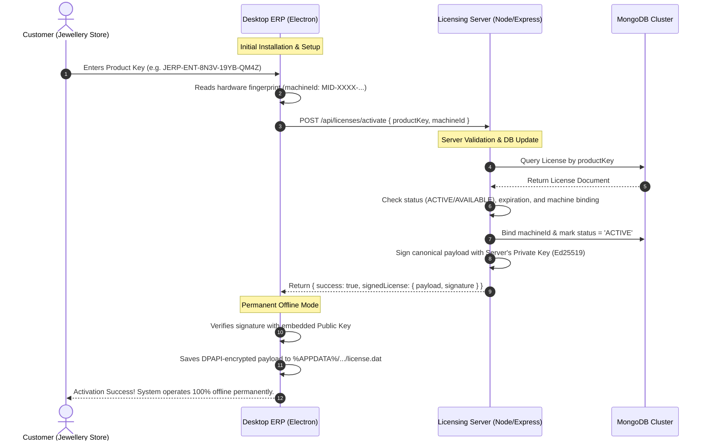

# Jewellery ERP Commercial Licensing Server

Production-grade, offline-first commercial licensing backend built with **Node.js, Express, MongoDB (Mongoose), and Ed25519 Asymmetric Cryptography**.

---

## 🏛️ Architecture Overview



---

## 📂 MongoDB Database Schema

The licenses are stored in the `licenses` collection in MongoDB:

```javascript
{
  "_id": ObjectId("6654a9f..."),
  "productKey": "JERP-ENT-8N3V-19YB-QM4Z",
  "edition": "ENTERPRISE",                     // "BASIC" | "PROFESSIONAL" | "ENTERPRISE"
  "status": "ACTIVE",                          // "AVAILABLE" | "ACTIVE" | "SUSPENDED" | "REVOKED" | "EXPIRED"
  "customerName": "Royal Diamond & Gold Jewels",
  "firmName": "Royal Jewels Flagship Store",
  "customerEmail": "billing@royaljewels.com",
  "phone": "+91 9876543210",
  "boundMachineId": "MID-4F8A-9B2C-1E3D-7A5F", // Fixed to customer's PC on activation
  "maxAllowedMachines": 1,
  "activations": [
    {
      "machineId": "MID-4F8A-9B2C-1E3D-7A5F",
      "activatedAt": ISODate("2026-09-16T12:00:00Z"),
      "ipAddress": "203.0.113.195",
      "appVersion": "1.0.0"
    }
  ],
  "activatedAt": ISODate("2026-09-16T12:00:00Z"),
  "expiresAt": ISODate("2027-09-16T12:00:00Z"), // null for Lifetime/Perpetual
  "customFeatures": [],
  "notes": "Annual subscription billed via Stripe",
  "createdAt": ISODate("2026-09-16T10:00:00Z"),
  "updatedAt": ISODate("2026-09-16T12:00:00Z")
}
```

---

## 🚀 Quick Start Guide

### 1. Install Dependencies
```bash
cd license-server
npm install
```

### 2. Configure Environment Variables
Copy `.env.example` to `.env`:
```bash
cp .env.example .env
```
Edit `.env` with your MongoDB connection string (local `mongodb://localhost:27017/...` or MongoDB Atlas URI).

### 3. Start the Server
```bash
# Production mode
npm start

# Development mode (with auto-reload)
npm run dev
```

---

## 🛠️ CLI Management Tool

Manage product keys directly from your terminal:

```bash
# 1. Create a new 1-year Enterprise License
node cli.js create ENTERPRISE "Kalyan Jewellers" "Mumbai Branch" 365

# 2. Create a Lifetime Basic License
node cli.js create BASIC "Shree Ganesh Store" "Delhi Main"

# 3. List all licenses and their current machine bindings
node cli.js list

# 4. Reset machine binding (e.g., if a customer replaced their motherboard or bought a new PC)
node cli.js reset JERP-ENT-8N3V-19YB-QM4Z

# 5. Revoke a license
node cli.js revoke JERP-ENT-8N3V-19YB-QM4Z
```

---

## 🌐 REST API Reference

### 1. Activate License (Called by Desktop App)
- **URL**: `POST /api/licenses/activate`
- **Body**:
  ```json
  {
    "productKey": "JERP-ENT-8N3V-19YB-QM4Z",
    "machineId": "MID-4F8A-9B2C-1E3D-7A5F",
    "product": "JEWELLERY_ERP",
    "appVersion": "1.0.0"
  }
  ```
- **Response**:
  ```json
  {
    "success": true,
    "message": "License activated successfully.",
    "signedLicense": {
      "payload": {
        "licenseId": "LIC-6654A9F...",
        "product": "JEWELLERY_ERP",
        "edition": "ENTERPRISE",
        "status": "ACTIVE",
        "machineId": "MID-4F8A-9B2C-1E3D-7A5F",
        "customerName": "Royal Diamond & Gold Jewels",
        "firmName": "Royal Jewels Flagship Store",
        "activatedAt": "2026-09-16T12:00:00.000Z",
        "expiresAt": "2027-09-16T12:00:00.000Z",
        "features": [
          "FEATURE_SALES",
          "FEATURE_PURCHASE",
          "FEATURE_INVENTORY",
          "FEATURE_ACCOUNTING",
          "FEATURE_REPORTS",
          "FEATURE_GST",
          "FEATURE_BARCODE",
          "FEATURE_JOB_WORK",
          "FEATURE_APPROVALS",
          "FEATURE_ORDERS",
          "FEATURE_ADVANCED_REPORTS",
          "FEATURE_CONSIGNMENT",
          "FEATURE_MANUFACTURING",
          "FEATURE_TAGGING_RFID"
        ],
        "version": 1
      },
      "signature": "3f8e4a91b..."
    }
  }
  ```

---

### 2. Admin: Generate Product Keys
- **URL**: `POST /api/admin/licenses/create`
- **Headers**: `x-api-key: adm_secret_key_998877`
- **Body**:
  ```json
  {
    "edition": "ENTERPRISE",
    "customerName": "Malabar Gold & Diamonds",
    "firmName": "Malabar Flagship",
    "customerEmail": "admin@malabar.com",
    "validityDays": 365,
    "quantity": 1
  }
  ```

---

### 3. Admin: Reset Hardware Machine ID
- **URL**: `POST /api/admin/licenses/reset-machine`
- **Headers**: `x-api-key: adm_secret_key_998877`
- **Body**:
  ```json
  {
    "productKey": "JERP-ENT-8N3V-19YB-QM4Z"
  }
  ```

---

## 🔒 Security Summary

1. **Zero Key Exposure**: Desktop apps never contain the private signing key. Only the public verification key is embedded.
2. **Hardware Locking**: The server binds the product key to the client's `machineId` on the first activation attempt. Any subsequent attempt on another PC is rejected with a 403 error.
3. **Cryptographic Integrity**: The signature is generated across a canonically ordered JSON payload with Ed25519, preventing tampering with expiration dates, features, or machine IDs.
